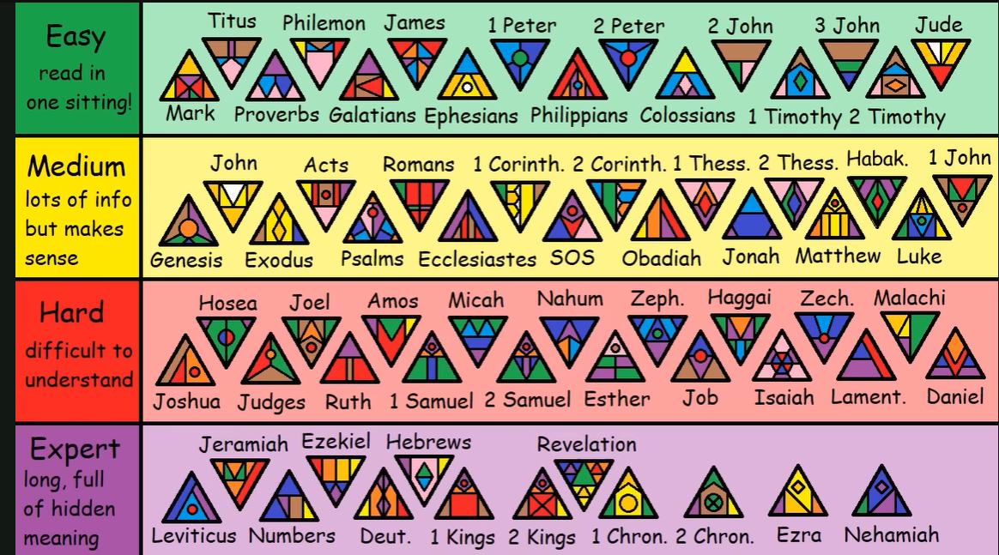

TODO:
- [ ] Sovereignty
- [ ] Terms

# Overview
WIP

## Introduction

> **Theology** - the <u>study</u> of the nature of God and religious belief

- https://www.crossway.org/articles/what-is-theology
  - *"Good theology is based in the belief that God exists, is personal, can be known, and has revealed himself. These presuppositions motivate theologians to devote themselves to a passionate pursuit of knowledge from God’s Word."*
  - *"Fully loving God and obeying the Great Commandment requires actively engaging the mind in the pursuit of truth."*
- https://www.gotquestions.org/Christian-theology.html
  - *"Christian theology is the study of what the Bible teaches and what Christians believe."*

What is Doctrine?

> **Doctrine** - are <u>teachings</u> (instructions) that are based on an authoriative source such as the Bible.

## Terms

- `Cessationism` - The belief that certain spiritual gifts, such as prophecy, healing, and speaking in tongues, ceased to be given by God after the Apostolic age.
  - https://www.gotquestions.org/cessationism.html
  -   * Calvinists believe the "gifts" were required to authenticate the ministry of Jesus and the apostles.
- `Doctrine` - Set of beliefs held and taught by a Church
- `Credobaptism` - Practice of baptizing only individuals who profess faith in Jesus Christ
- `Paedobaptism` (pay.doo) - Infant baptism. Reform based on OT circumcision.
- `Eschatological` - view of “end times” prophecies of the Bible
- Biblical authority:
  - `Inspiration` -
  - `Infallibility` -
  - `Inerrancy` -

## Areas

### Sovereignty

#### Questions

1. What is God sovereign over? Does He control if I go to store A vs store B?
Christian theology teaches that God is sovereign over everything (Psalm 115:3; Proverbs 16:9; Ephesians 1:11). However, the way His sovereignty interacts with human choices is a deep mystery. Some traditions emphasize God’s meticulous control over all details, while others speak of His sovereignty working through, not against, human freedom. Scripture affirms both God’s ultimate authority and our real agency. Whether God specifically ordains "store A vs store B" isn’t always clear—sometimes it’s more about trusting His providence whatever choice we make.

1. Where does Christian freedom to make choices come in vs. sovereignty?
Christian freedom means we are invited to make wise, responsible choices within God’s moral will (Galatians 5:1, 13). We’re not robots. God’s sovereignty is not meant to paralyze us, but to give us confidence that He is working all things for our good (Romans 8:28), even when we don’t know all the details. We pray, seek wisdom, make decisions, and trust God with the outcome.

#### Ligonier:
- [ ] https://learn.ligonier.org/articles/what-does-it-mean-that-god-is-sovereign
- [ ] https://learn.ligonier.org/podcasts/ultimately-with-rc-sproul/is-gods-sovereignty-limited-by-human-freedom

#### GotQuestions:
- [ ] https://www.gotquestions.org/God-is-sovereign.html
- [ ] https://www.gotquestions.org/is-God-sovereign.html
- [ ] https://www.gotquestions.org/Gods-will.html

#### Desiring God:
- [ ] https://www.desiringgod.org/interviews/what-is-the-sovereignty-of-god
- [ ] https://www.desiringgod.org/interviews/is-god-sovereign-over-my-free-will

#### Misc:
- [ ] https://www.thegospelcoalition.org/essay/divine-sovereignty-human-freedom/
- [ ] https://coldcasechristianity.com/writings/does-gods-sovereignty-rob-us-of-our-freedom/

### Hell

- `Hell` - [R.C. Sproul - The Problem with Hell](https://www.youtube.com/watch?v=5YzGYRakRes)
- https://www.youtube.com/watch?v=_cnUwbgpNKc - R.C. Sproul
- https://www.gotquestions.org/eternal-damnation.html - offensive
- https://www.gotquestions.org/loving-God-send-someone-hell.html
- `ECT` - Enternal Conscious torment
- `Annihilationism` - ceasing to exists
- https://bibleproject.com/podcast/series/heaven-hell/
- https://timothykeller.com/blog/2008/8/1/the-importance-of-hell
- https://podcast.gospelinlife.com/?s=Hell

### Trinity
- https://www.gotquestions.org/Trinity-Bible.html

  > "The doctrine of the Trinity has been a divisive issue throughout the entire history of the Christian church. While the core aspects of the Trinity are clearly presented in God’s Word, some of the side issues are not as explicitly clear. The Father is God, the Son is God, and the Holy Spirit is God—but there is only one God. That is the biblical doctrine of the Trinity. Beyond that, the issues are, to a certain extent, debatable and non-essential."

### Dispensationalism

- Known for its distinctive [eschatology](https://en.wikipedia.org/wiki/Eschatology) (s.ca.tall.la.g) doctrines.
- Originated in the 19th century in the teachings of John Darby. The Scofield's Bible (1909) also contributed with its study notes.
- Up holds the doctrine of the pre-tribulation rapture of the church.
  - Church raptured, taken to heaven before the second coming.
  - Will be a seven-year period of tribulation
  - The second coming is at the end of the tribulation.
  - There will be 1,000 years called the Millennial Kingdom.
- Holds that there are two distinct people of God - **Israel** and the **Church**.

> Note that Reform "covenant" theology holds that there is one people of God.

References:
- https://www.ligonier.org/learn/articles/dispensationalism
- https://www.gotquestions.org/dispensationalism.html

### Eschatology
The theological study of "last things". Includes the end of history, Christ's return, resurrection, final judgment, and the creation of a new heaven and earth.

[Millennialism](https://www.gotquestions.org/millennialism.html) - Millennialism is the belief in a literal reign of Christ on earth for 1,000 years in the future.

`Premillennialism`: Believes Christ returns before a literal 1,000-year reign on Earth. It is often divided into Dispensational (involving a rapture) and Historic (focusing on the church) views. Common in Baptist and Pentecostal circles.

`Postmillennialism`: Argues Christ returns after the world is Christianized through the Gospel. This view emphasizes gradual societal improvement and was popular in the 19th century; it remains a minority view in some Reformed traditions.

`Amillennialism`: Interprets the 1,000 years symbolically as the current church age where Christ reigns from heaven. Held by Roman Catholic, Eastern Orthodox, and many Reformed (Presbyterian/Lutheran) denominations.

`Preterism` (pret.er.ism) - view that the “end times” prophecies of the Bible have already been fulfilled.

[Partial preterists](https://www.gotquestions.org/partial-preterism.html) - Those who hold to partial preterism believe that the prophecies in Daniel, Matthew 24, and Revelation (with the exception of the last two or three chapters) have already been fulfilled and were fulfilled no later than the first century AD. According to partial preterism, there is no rapture, and passages describing the tribulation and the Antichrist are actually referring to the destruction of Jerusalem in AD 70 and the Roman emperor Titus. Partial preterists do believe in the return of Christ to earth and a future resurrection and judgment, but they do not teach a millennial kingdom or that Israel as a nation has a place in God’s future plan. According to partial preterists, the Bible’s references to “the last days” are speaking of the last days of the Old Jewish Covenant, not the last days of the earth itself. Note that partial preterists believe that full preterism is heresy.

#### Preterism
https://www.gotquestions.org/search-results.html?q=preterist#gsc.tab=0&gsc.q=preterist&gsc.page=1

### Other

- [Women Pastors - got questions](https://www.gotquestions.org/women-pastors.html)
- `Progressive Christianity` - TBD
  - https://www.gotquestions.org/progressive-Christianity.html
- `New Apostolic Reformation` (NAR) - A religious *movement* that emphasizes **experience** over **Scripture**, **mysticism** (*altered state of consciousness given religious meanining*) over **doctrine**, and the concerpt of mondern-day **apostles**.
  - https://www.gotquestions.org/New-Apostolic-Reformation.html
  - Apostoloic (*ap.a.stall.lic*)
- The meaning of Genesis 1: 26 ["Let us make man in our image"](https://www.bibleref.com/Genesis/1/Genesis-1-26.html)
  - A number of explanations, but primary is that God is speaking as a **Trinity**, of Father, Son, and Holy Spirit.
  - Gen 1:2 describes the Spirit of God hovering over the waters.
  - Jone 1:1-3 revelas that the Word, Christ, was active in the  creation of all things.
- `Anabaptists` - a 16th-century Radical Reformation movement originating in Zurich (c. 1525) that emphasizes believers' baptism (Credo), strict separation of church and state, and biblical pacifism. Core beliefs include adult baptism, communal living, non-resistance, and separation from society, with modern branches including Mennonites, Amish, and Hutterites.

## Bible Books based on Difficulty

| Difficulty | Books (Top Row) | Books (Bottom Row) |
|---|---|---|
| **Easy** read in one sitting! | Titus, Philemon, James, 1 Peter, 2 Peter, 2 John, 3 John, Jude | Mark, Proverbs, Galatians, Ephesians, Philippians, Colossians, 1 Timothy, 2 Timothy |
| **Medium** lots of info but makes sense | John, Acts, Romans, 1 Corinth., 2 Corinth., 1 Thess., 2 Thess., Habak., 1 John | Genesis, Exodus, Psalms, Ecclesiastes, SOS, Obadiah, Jonah, Matthew, Luke |
| **Hard** difficult to understand | Hosea, Joel, Amos, Micah, Nahum, Zeph., Haggai, Zech., Malachi | Joshua, Judges, Ruth, 1 Samuel, 2 Samuel, Esther, Job, Isaiah, Lament., Daniel |
| **Expert** long, full of hidden meaning | Jeremiah, Ezekiel, Hebrews, Revelation | Leviticus, Numbers, Deut., 1 Kings, 2 Kings, 1 Chron., 2 Chron., Ezra, Nehemiah |
